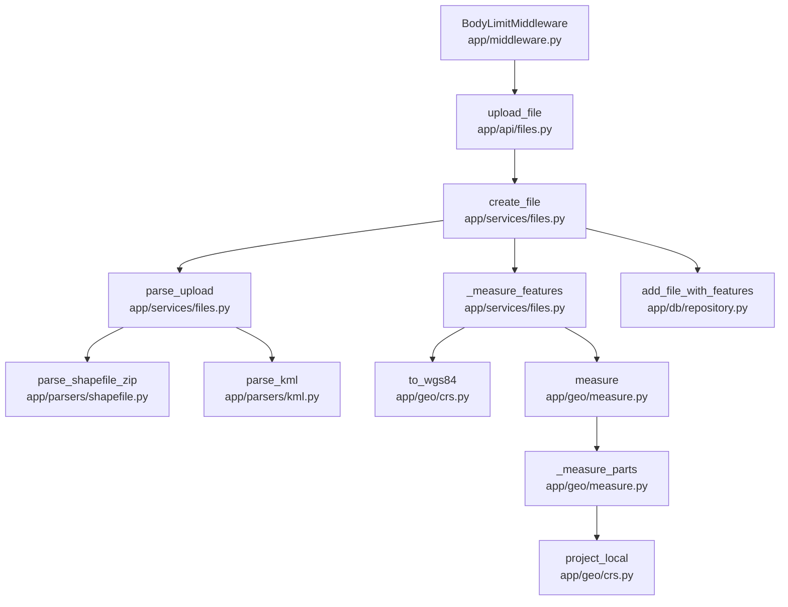

# Geospatial File Measurement API

Upload a zipped Shapefile or a KML file; the API extracts every feature and measures polygon
**area** and line **length** in metres, using projected coordinate systems (never degrees).

FastAPI, SQLAlchemy + SQLite, shapely 2, pyproj, pyshp, defusedxml. No GDAL, GeoPandas, fiona
or pyogrio.

> Requirement-by-requirement status (tests, gaps, mismatches): [Requirements traceability](docs/compliance.md).

## Features

- The format is detected from the file content, not the filename.
- Polygon area in m² and line length in m, each part measured in its own local equal-area or
  equidistant projection. Points get no measurement, with a reason.
- The source CRS is read from the `.prj`; geometry is returned as GeoJSON in EPSG:4326.
- Invalid polygons are reported (`is_valid`, `validity_reason`) and repaired before measuring.
  Features that cross the antimeridian are unwrapped.
- File details, paged measurements and a paged list of uploads, stored in SQLite, with warnings
  per file and per feature.
- One error body shape, and limits on size, ZIP entries, features, vertices, parts and XML.

## Supported formats

- **Zipped Shapefile:** one shapefile per ZIP, subfolders allowed, with `.shp`, `.shx` and
  `.dbf`. `.prj` gives the CRS (without it, EPSG:4326 is assumed only when every coordinate fits
  lon/lat) and `.cpg` the attribute encoding. Points, multipoints, lines and polygons; Z values
  are dropped.
- **KML:** Placemarks with `Point`, `LineString`, `LinearRing`, `Polygon` (with holes) and
  `MultiGeometry`. `name`, `description` and `ExtendedData` become properties; altitude is
  dropped. Other geometry, such as `gx:Track`, is kept as a feature without geometry and with a
  warning.
- Not accepted: KMZ and ZIPs holding several shapefiles (400). Well-formed XML that is not KML,
  and content that is neither ZIP nor XML, get 415.

## Setup

Requires Python 3.11 or newer (the test suite passes on 3.11, 3.12 and 3.13). No system
libraries are needed: every dependency installs from a pip wheel. `requirements.lock` pins the
exact versions the test suite passed with, so install from it:

```bash
git clone https://github.com/amiya-09/Geospatial-File-Measurement-API geo-measure-api && cd geo-measure-api
python -m venv .venv      # use python3 if `python` is not on your PATH
. .venv/bin/activate
pip install -r requirements.lock
pip install -e . --no-deps
```

`pyproject.toml` keeps loose version bounds. `pip install -e ".[dev]"` instead of the two pip
lines above installs the latest releases. The lock was generated and tested on Linux only.

## Running

```bash
uvicorn app.main:app --port 8000
```

- Interactive docs: <http://127.0.0.1:8000/docs> (OpenAPI JSON at `/openapi.json`).
- Health check: `GET /health`.
- The SQLite file is `geo_api.db` in the directory you start the server from (SQLite also
  creates `geo_api.db-wal` and `geo_api.db-shm` next to it while running); set
  `GEO_API_DB=/path/to/file.db` to change it. Tables are created at startup.
- Limits (upload size 25 MB, uncompressed ZIP size 100 MB, `.dbf` size 25 MB, ZIP entries,
  feature, vertex and part counts, the size of a polygon that may be repaired, XML depth and
  element count, concurrent uploads) are constants in `app/config.py`; only the database path is
  read from the environment.

Tests, lint and the end-to-end smoke check:

```bash
pytest
ruff check app tests scripts
bash scripts/smoke.sh        # starts its own server on a temp DB and port, uploads every file in samples/
python scripts/make_samples.py   # regenerates samples/ (deterministic)
python scripts/verify_independent.py http://127.0.0.1:8000   # needs a running server (see above)
```

Run these with the virtual environment activated: `smoke.sh` uses the `python` on your PATH
(override with `PYTHON=/path/to/python`). `verify_independent.py` imports nothing from `app`;
it recomputes every sample feature's area/length with `pyproj.Geod` and prints the API value,
the Geod value and the percent difference.

`TOTALITY_MUTATIONS=20000 pytest tests/test_parser_totality.py` runs the long fuzz pass over
both parsers.

## API reference

All paths end with a trailing slash and are never redirected. Every error uses one body shape:
`{"error": {"code": "...", "message": "..."}}` (the 422 for an unmeasurable file also carries
`file_id` inside `error`).

| Method and path | Purpose | Success |
|---|---|---|
| `POST /api/files/` | Upload a zipped Shapefile or KML (multipart field `file`) | 201 |
| `GET /api/files/{id}/` | File details | 200 |
| `GET /api/files/{id}/measurements/` | Per-feature measurements | 200 |
| `GET /api/files/` | List uploads, newest first (`limit` 1-200, `offset`) | 200 |

### Upload

```bash
curl -F "file=@samples/sample.kml" http://127.0.0.1:8000/api/files/
```

```json
{"id": "87b4a389-ba1e-468a-91a1-ff7d0157a07c", "filename": "sample.kml", "format": "kml",
 "feature_count": 4, "crs": "EPSG:4326", "status": "COMPLETED", "warnings": [], "error": null}
```

The format is chosen from the **content** (ZIP signature means Shapefile, otherwise KML is
tried); the filename is stored as metadata only. `crs` is the file's source CRS.

### File details

```bash
curl http://127.0.0.1:8000/api/files/87b4a389-ba1e-468a-91a1-ff7d0157a07c/
```

Returns the same object as the upload response.

### Measurements

```bash
curl "http://127.0.0.1:8000/api/files/87b4a389-ba1e-468a-91a1-ff7d0157a07c/measurements/?include_geometry=false&limit=2&offset=1"
```

```json
{
  "file_id": "87b4a389-ba1e-468a-91a1-ff7d0157a07c",
  "crs": "EPSG:4326",
  "total": 4,
  "limit": 2,
  "offset": 1,
  "features": [
    {
      "index": 1, "source_id": null, "geometry_type": "LineString", "crs": "EPSG:4326",
      "properties": {"name": "Footpath"},
      "measurement": {
        "area_m2": null, "length_m": 1791.5671887934911,
        "area_unit": null, "area_crs": null,
        "length_unit": "m",
        "length_crs": "+proj=aeqd +lat_0=52.522499999999994 +lon_0=13.407499999999999 +datum=WGS84 +units=m +no_defs +type=crs",
        "reason": null
      },
      "is_valid": true, "validity_reason": null, "warnings": [], "geometry": null
    },
    {
      "index": 2, "source_id": null, "geometry_type": "Polygon", "crs": "EPSG:4326",
      "properties": {"name": "Park with pond"},
      "measurement": {
        "area_m2": 1360077.2436689679, "length_m": null,
        "area_unit": "m2",
        "area_crs": "+proj=laea +lat_0=52.50499999999998 +lon_0=13.410277777777765 +datum=WGS84 +units=m +no_defs +type=crs",
        "length_unit": null, "length_crs": null, "reason": null
      },
      "is_valid": true, "validity_reason": null, "warnings": [], "geometry": null
    }
  ]
}
```

- `index` is the feature's position in the source file and is stable across requests.
- `geometry` is GeoJSON in **EPSG:4326** whatever the source CRS (`include_geometry=false`
  returns `null`). `crs` is the **source** CRS.
- Every measured value carries its unit and the local projected CRS it was computed in.
- A feature without usable geometry has `geometry: null`, `measurement.reason`
  `"no geometry"` and the parser's reason in `warnings`; points report `"not applicable"`. The
  other reasons are `"unsupported"`, `"empty geometry"` and `"no polygonal area after repair"`.
- `limit` (1-1000, default: all) and `offset` page through features; `total` is the full count.

Geometry of the polygon above (`include_geometry=true`), outer ring plus the hole:

```json
{"type": "Polygon", "coordinates": [[[13.4, 52.5], [13.42, 52.5], [13.42, 52.51], [13.4, 52.51], [13.4, 52.5]], [[13.405, 52.503], [13.41, 52.503], [13.41, 52.507], [13.405, 52.507], [13.405, 52.503]]]}
```

### List

```bash
curl "http://127.0.0.1:8000/api/files/?limit=1"
```

```json
[{"id": "61b3c931-930b-4a5e-8553-5b57e2edb8c5", "filename": "bad_no_prj.zip",
  "status": "FAILED", "feature_count": 0, "created_at": "2026-10-10T03:35:28.042176Z"}]
```

`created_at` is UTC ISO-8601 with a `Z` suffix.

### Errors

| Status | `error.code` | When |
|---|---|---|
| 400 | `invalid_file` | Empty, corrupt or unsafe file (bad ZIP, zip-slip, broken XML, over parser limits). Nothing is stored. |
| 400 | `invalid_request` | The request body cannot be parsed (a multipart body without a boundary, a broken one, or more than 1,000 parts). Nothing is stored. |
| 404 | `not_found` | Unknown file id. |
| 409 | `file_failed` | Measurements requested for a `FAILED` file; the stored error is returned. |
| 413 | `payload_too_large` | Body or file over `MAX_UPLOAD_BYTES` (25 MB). |
| 415 | `unsupported_media_type` | Content is neither a zipped Shapefile nor KML. |
| 422 | `validation_error` | Bad request (missing `file`, malformed UUID, paging out of range). |
| 422 | `unmeasurable_file` | Readable but not measurable (e.g. no `.prj` and coordinates are not lon/lat; a feature spanning more than 180 degrees of longitude; an invalid polygon with more than 350 vertices; more than 20,000 parts after repair; no feature left with a usable geometry). A `FAILED` record is stored; its id is `error.file_id`. |
| 503 | `server_busy` | Four uploads are already being processed and no slot freed up within 2 s. Nothing is stored; retry after the `Retry-After` seconds (5). |
| 503 | `database_busy` | The database write lock or a pooled connection was not free within 5 s. Nothing is stored; retry after the `Retry-After` seconds (5). |
| 500 | `internal_error` | Anything unexpected. Generic body; the traceback is only logged. |

```bash
curl -F "file=@samples/bad_no_prj.zip" http://127.0.0.1:8000/api/files/    # 422
```

```json
{"error": {"code": "unmeasurable_file", "message": "no .prj file and coordinates are outside the lon/lat range, so the coordinate system cannot be determined", "file_id": "61b3c931-930b-4a5e-8553-5b57e2edb8c5"}}
```

```bash
curl -F "file=@samples/bad_not_a_map.kml" http://127.0.0.1:8000/api/files/   # 415
```

```json
{"error": {"code": "unsupported_media_type", "message": "unsupported file type: expected a zipped Shapefile or KML"}}
```

## Project structure

```
app/
  main.py            app factory, router, middleware, startup (creates tables)
  config.py          database path and processing limits
  middleware.py      request body cap (Content-Length, then streamed byte count)
  errors.py          ApiError, one error body shape, exception handlers
  schemas.py         response models and OpenAPI examples
  api/files.py       the HTTP routes (plain `def` handlers)
  services/
    files.py         upload pipeline: read, detect, parse, measure, persist
    serialize.py     JSON-safe values, GeoJSON output
  parsers/
    base.py          ParsedFile, Feature, ParseError, UnmeasurableError, VertexBudget
    kml.py           KML parser (defusedxml)
    shapefile.py     zipped Shapefile parser (zipfile + pyshp)
  geo/
    crs.py           reprojection to WGS84, local LAEA / AEQD projections
    measure.py       area and length of WGS84 geometries
  db/                SQLAlchemy models, engine/session, repository
scripts/             make_samples.py (sample generator), smoke.sh (curl end-to-end check),
                     verify_independent.py (Geod check), make_accuracy_doc.py (writes docs/accuracy.md)
samples/             generated good and bad input files
tests/               pytest suite
docs/decisions.md    decision log
docs/accuracy.md     accuracy table against pyproj.Geod
docs/compliance.md   requirements traceability
plan.md              the agreed plan
```

## File-processing flow

The upload path through the code (each box is a function and the file it is in):



1. **Body cap.** Middleware rejects a declared `Content-Length` over the cap with 413 before
   reading anything, and counts bytes for chunked bodies.
2. **Wait for a slot.** At most four uploads are read, parsed and measured at once. Another
   upload waits up to 2 s for a slot, then gets 503 `server_busy` before its body is read into
   memory. GET requests never wait for a slot.
3. **Read.** The upload is read in chunks, stopping with 413 once `MAX_UPLOAD_BYTES` is
   exceeded.
4. **Detect by content.** `PK\x03\x04` means zipped Shapefile; otherwise the KML parser runs.
   Well-formed XML that is not `<kml>` or unrecognised bytes give 415; broken ZIP/XML gives 400.
5. **Parse.** Parsers return a `ParsedFile` (source CRS, features, warnings) or raise
   `ParseError` (unreadable, 4xx, nothing stored) / `UnmeasurableError` (stored as `FAILED`, 422).
   - Shapefile ZIP: path-safety (zip-slip) checks, entry-count and size caps (the `.dbf` at most
     25 MB) enforced on bytes actually read, encrypted entries rejected, exactly one shapefile
     required, `.prj` read for the CRS, `.cpg` for the text encoding (only known text encodings;
     anything else is ignored with a warning and UTF-8 is assumed), DBF records flagged deleted
     are skipped.
   - KML: DTDs and entities forbidden, nesting depth, element count (500,000), feature and
     vertex limits; a Placemark with bad geometry becomes a feature with `geometry: null` and a
     warning.
   - Both: at most 20,000 lines and polygon rings per upload, counted before any geometry is
     built (400 above that). A feature with a coordinate outside longitude +/-180 or latitude
     +/-90 (KML, or a shapefile in a lon/lat CRS) is kept with `geometry: null` and a warning.
   - If the file has features but none of them is left with a usable geometry, the file is
     unmeasurable (422, `FAILED` record). Files with some usable features are stored as usual.
6. **Measure** each feature (next section).
7. **Persist** the file row and all feature rows in one transaction.
8. **Respond** with the file info (201). Failures after parsing store a `FAILED` record.

## Measurement flow

For each feature with geometry:

1. Reproject from the source CRS to EPSG:4326 (lon/lat, `always_xy`), dropping Z/M.
2. Reject non-finite coordinates and values outside lon/lat range (strictly, no tolerance).
3. Split Multi* geometries and collections into parts, skipping empty parts.
4. Antimeridian: a part spanning more than 180 degrees of longitude is retried with negative
   longitudes shifted by +360; if it still spans more than 180 degrees, or the shift would
   collapse it to zero size (a feature that goes all the way round the globe), the file is
   unmeasurable (422). A warning is recorded when the shift is applied.
5. Check validity on the unwrapped parts. All polygons of one feature, including those inside a
   mixed collection, are checked together, so overlapping members count as invalid. Invalid
   polygons are repaired together (`make_valid` with the "structure" method, which unions
   overlaps) and reported with `is_valid: false` and the reason. A warning gives both areas when
   the repair changed the area. An invalid polygon with more than 350 vertices is not repaired;
   the file is unmeasurable (422).
6. For each part, build a local projection centred on the part's centroid and project into it:
   **Lambert azimuthal equal-area** for area, **azimuthal equidistant** for length.
7. Measure in metres, sum the parts, and attach the unit and local CRS to each value.

## CRS handling summary

- Source CRS comes from the `.prj` (Shapefile) or is EPSG:4326 (KML). With no `.prj`, EPSG:4326
  is assumed only if every coordinate fits lon/lat; otherwise the file is unmeasurable (422).
- `crs` in responses is `EPSG:<code>` when pyproj can identify it, otherwise the CRS name.
- Geometry is always returned in EPSG:4326.
- Areas and lengths are never computed in degrees, nor in the source CRS: always in a local
  equal-area (area) or equidistant (length) projection.
- Accuracy limits: straight edges are projected, not geodesic, so very large shapes differ
  slightly from a geodesic calculation (a 10-degree box: about -0.4% area).

## How I built this

I built this project in phases using Claude Code, Anthropic's AI coding agent. Claude Code wrote
the code and the tests, and I, Amiya Singh, directed, reviewed and tested it. Claude Code also
drafted the documentation, including this section. I mainly wrote the instructions and made the design decisions at each stage. I reviewed the implementation and test results, investigated problems, and worked to understand why the code behaved the way it did.

The work went in this order:

1. A written plan first. `plan.md` holds the requirements checklist, the architecture, the
   projection strategy, the main risks and the failure policy. Before any code I added the
   failure policy, the `warnings` and `is_valid` fields and the exact route paths to it.
2. Reference values before measurement code. `tests/expected_values.py` holds areas and lengths
   computed only with `pyproj.Geod`, and it was committed before any measuring code existed.
3. Five stages, each ending with a written report and a stop: the measurement core, the two
   parsers, the API with SQLite storage, hardening (the body size limit, paging, sample files and
   a smoke script), and last a requirements matrix (`docs/compliance.md`), an independent check
   script, CI and a run from a fresh clone. Each report showed the real test output and listed
   the decisions still open. Where a report offered options, I picked one, for example
   unwrapping features that cross the antimeridian instead of rejecting them.
4. A finishing round: an audit of the CRS handling against Geod, load and fuzz testing with
   fixes, a read only security and code review by two separate Claude Code agents, a fix round
   for the findings I approved, this writing pass, and a final check from a fresh clone of the
   public repository before submission.

How the work was checked:

- Tests first. For new behaviour and for bug fixes, the test was written and seen to fail
  before the code changed. A few tests that pinned behaviour already in place passed at once.
  The suite has 459 tests and runs in CI on Python 3.11 and 3.12.
- A fuzz test, `tests/test_parser_totality.py`. It takes valid KML files and shapefile ZIPs,
  corrupts them in seeded random ways (truncated, flipped, inserted, deleted and overwritten
  bytes), and checks that the parsers either return a result or raise one of their own errors
  within 5 s. It found four bugs that would have been 500s, and its long run (20,000 corrupted
  inputs per target) passes.
- An independent check against `pyproj.Geod`. `scripts/verify_independent.py` imports nothing
  from `app`. It recomputes every sample feature with Geod and compares that with what the
  running API returns. All five measurable sample features agree within 0.0000%.
- QGIS gave 755,598.48 m² for the Berlin polygon (corners 13.40,52.50 and 13.41,52.51), and the
  API gave the same figure.
- Property tests with hypothesis (for example, a polygon's area does not change with its
  starting vertex or ring direction), and a schemathesis run against the OpenAPI schema, which
  found one 500 (an `offset` of 2^63) and a missing `Allow` header.

I reviewed the implementation in stages and used tests to catch problems that normal testing might miss. Comparing the API’s results against an independent Geod calculation also helped me check whether the measurements were actually correct, rather than just trusting my own code.

## Design decisions and alternatives

The full log, with the numbers behind each entry, is in [docs/decisions.md](docs/decisions.md).
In short:

Projection. I measure area in a Lambert azimuthal equal-area projection and length in an
azimuthal equidistant projection. The code builds one for every part of every feature, centred on
that part's centroid, and sums the parts. LAEA keeps area and AEQD keeps distances from its
centre. I rejected one projection for everything, such as Web Mercator, which makes a 1 degree
box at 60N about four times too big. Large shapes are where it breaks: a 10 degree box comes out
0.38% smaller than Geod's answer, because my edges are straight lines in the projection and
Geod's are geodesics.

Reprojection. Every geometry goes through EPSG:4326 first, even from a projected file, with
`always_xy=True` on every transformer. I do not measure a projected file in its own units. The
NAD83 to WGS84 step is approximate (about 4 m), which changed a test box's area by about
0.00003%.

Libraries. I use pyshp for shapefiles and my own KML parser on defusedxml, instead of GDAL based
readers such as pyogrio or fiona, so that everything installs from pip wheels. The cost is fewer
formats and my own ZIP handling. pyshp still turns a polygon ring with one point into a 400 for
the whole file.

Failure policy. An unreadable file is a 4xx and nothing is stored. A readable file that cannot be
measured is stored as `FAILED` and answered with 422 and its id. A problem in one feature only
removes that feature's geometry, with a warning, and a file with no usable geometry left is a
422. I do not guess a missing CRS. The weak spot is that a feature that fails during measurement
still fails the whole file.

Missing `.prj`. EPSG:4326 is assumed, with a warning, only when every coordinate fits lon/lat;
otherwise the file is a 422. I rejected refusing all such files. The fallback cannot tell degrees
from small projected numbers: a 40 m square drawn near 10,10 in a local CRS is read as degrees.

Processing inside the request. Uploads are processed while the client waits, at most four at a
time. The next one waits up to 2 s and then gets 503 `server_busy`. I rejected background jobs
for now. In a burst of 60 uploads, 56 clients have to retry.

Antimeridian. A part wider than 180 degrees of longitude is retried with negative longitudes
shifted by +360. The narrower version wins, with a warning, and if both are wider than 180
degrees the file is a 422. Rather than reject such features, I unwrap them. The rule cannot know
what was meant: a box from -170 to 170 is read as 20 degrees wide across 180.

Invalid polygons. The polygons of one feature are checked and repaired together with
`make_valid` (the "structure" method), flagged with `is_valid: false`, and refused above 350
vertices. The cap trades away some cheap repairs, such as a 10,000 vertex bow tie, to keep the
worst repair near 1.5 s.

## Learnings

This project taught me that getting the basic functionality working is only the first step. Handling edge cases, testing assumptions, and understanding why a design works are just as important as writing the code.

Degrees are not metres. A 1 by 1 degree box covers about 12,309 km2 between the equator and 1N,
and about 6,123 km2 between 60N and 61N, because a degree of longitude covers less ground away from the equator. A
calculation done directly on longitude and latitude gives both boxes the same number. That is
why nothing in this API is measured in degrees.

Coordinates mean nothing without their CRS. `391390, 5817855` is a corner of the sample park in
Berlin in UTM zone 33N, and a different place in another CRS. So when a shapefile has no `.prj`,
the API does not guess, unless every number fits the lon/lat range.

Each projection keeps some properties and gives up others. Web Mercator is good for web maps but
does not keep area. LAEA keeps area and AEQD keeps distances from its centre, so I use one for
each. The projection also has to sit near the shape: an AEQD map centred on Berlin would give an
inaccurate length for a footpath in Sydney.

A reference should not share my method. If my reference used the same kind of projection as
my code, both could share the same distortion or the same bug. `pyproj.Geod` works on the WGS84
ellipsoid instead, so agreement with it means more. The comparison still needs a tolerance,
because projected and geodesic results differ for large shapes. The worst bug the review found
(+2197%) was measured against Geod.

A file's description of itself cannot be trusted. A ZIP header can claim that an entry is 10
bytes when it unpacks to 5 GB. The parser reads at most the remaining budget plus one byte, and
if that extra byte arrives, the archive is over the limit and is rejected.

Bad input must not become a 500. The fuzz test found that an XML declaration with an unknown
encoding raised an uncaught `LookupError`. The fault was in the input, not in the server, so it
is now a 400.

Order matters in a pipeline. My first version checked and repaired polygons before unwrapping
them across the antimeridian. A wrapped box together with a small box at longitude 10 then
measured 2197% too large.

The worst case needs its own limit. Repairing a self intersecting polygon is fast for most
shapes, but a star with 141 vertices took about 30 s. The 350 vertex cap applies only to invalid
polygons that need repair, so a valid coastline with 50,000 vertices is still measured. The
price is that the cap can also reject an invalid polygon that would have been cheap to repair.

A fast endpoint can still be slow under load. `/health` does almost no work, yet it took 27 s
while uploads were waiting, because it needed a free worker thread and the uploads held them. As
an `async` function it answers on the event loop instead, in 7.9 ms (median) during a burst of 60
uploads. The uploads did not get faster, since parsing and measuring are CPU bound. The four
upload slots only limit how many run at once.

Partial success needs a rule for when nothing is left. A KML with a valid polygon, a polygon
with a corner at latitude 95 and a Placemark without geometry is a 201: the first is measured,
and the other two are kept with `geometry: null` and a warning. Without the valid polygon the
same file is a 422, because no feature has a usable geometry.

Next time, I’d test the difficult edge cases earlier instead of discovering them late in development. I’d also spend more time understanding the trade-offs behind each design decision before implementing it, so I could catch problems sooner and explain the reasoning more confidently.

## Known limitations and deviations

The M numbers refer to the mismatch table in [docs/compliance.md](docs/compliance.md).

Where the API differs from the assignment or from `plan.md`:

- The plan says a file goes from `PROCESSING` to `COMPLETED` or `FAILED`. Processing happens
  inside the request, so `PROCESSING` is never stored or returned (M3).
- The plan says a point gets `measurement: null` with a reason. The API returns a `measurement`
  object whose values are all `null`, with `reason` set (`"not applicable"`, `"unsupported"`,
  `"no geometry"`, `"empty geometry"`, `"no polygonal area after repair"`), so every feature has
  the same shape (M4).
- Ids are UUID strings. The assignment's example shows `"abc123"`: the same type, a different
  value (M5).
- The assignment does not define the measurements response. It is an object
  `{file_id, crs, total, limit, offset, features}`, not a bare list (M6).
- `created_at` is returned only by the list endpoint, not by the file details, because I kept the
  file details to the assignment's example (M12).

Limits and known problems:

- The 25 MB cap is checked on the bytes read and by the body middleware, but Starlette writes the
  multipart body to a temporary file before the route runs. So a request of up to 25 MB plus
  64 KiB reaches the disk before the cap applies (M11).
- The body middleware has a sharp edge. When a chunked upload (no `Content-Length`) passes the
  limit, it cannot simply raise an error, because FastAPI turns that exception into a 400 (found
  while testing chunked uploads). Instead it tells the app that the client disconnected, throws away whatever the app
  sends, and sends its own 413. It can only do that if the app has not started its response yet. The upload
  route never answers before the whole body is read, but a route that did would send a cut off
  response (read from the code, not tested). The middleware's limit is 64 KiB above
  `MAX_UPLOAD_BYTES`, to leave room for the multipart headers, so its 413 names 26,279,936 bytes
  while the route's 413 names 26,214,400. A `Content-Length` that is not a number is passed on to
  the server unchanged.
- A feature that fails during measurement (wider than 180 degrees of longitude, invalid polygons
  with more than 350 vertices, more than 20,000 parts after repair) fails the whole file with
  422, while a feature the parsers cannot read only loses its own geometry.
- A feature whose polygons are invalid and hold more than 350 vertices in total (counted as
  stored, closing vertices included) is not repaired, and the upload gets 422. Repair time grows
  sharply with the number of self crossings: a 350 vertex star polygon took about 1.5 s. The cap
  counts vertices, not crossings, so a 10,000 vertex bow tie that would repair in about 0.01 s is
  rejected too.
- An upload may hold at most 20,000 lines and polygon rings (points do not count). They are
  counted before geometry is built (400 above that) and again after repair (422).
- A coordinate outside longitude +/-180 or latitude +/-90 drops that feature's geometry with a
  warning (KML, or a shapefile in a lon/lat CRS), and the rest of the file is stored (201). When
  no feature is left with a usable geometry, for example a KML written in projected coordinates,
  the upload is 422. The same applies to a KML whose Placemarks carry no geometry at all, while a
  KML with no Placemarks is still 201 with zero features.
- A feature written with continuous longitudes past 180 (179 to 181) counts as out of range, so
  it loses its geometry. Only the wrapped form (179 to -179) is measured across the antimeridian.
- Without a `.prj`, a shapefile whose numbers all fit lon/lat is read as degrees, even if it is
  really in a projected CRS. A 40 m by 40 m square with corners at 10,10 and 50,50 measured
  16,039,424,623,573 m2, with only a warning (checked with a scratch script, not a committed
  test).
- Polygons that share an edge or overlap inside one feature (a MultiPolygon or a mixed collection)
  are reported invalid and measured as their union, with a warning when that changed the area.
- A `.cpg` naming anything other than a known text encoding is ignored with a warning and UTF-8
  is assumed. ESRI numeric ISO 8859 codes such as `88595` are not recognised.
- At most four uploads are parsed and measured at once, in one process. With 60 uploads of 1,500
  polygons sent at once, 4 returned 201 and 56 returned 503 `server_busy` within 11.2 s, and
  `/health` answered in 7.9 ms (median) and 965 ms at worst. More slots would not add speed: each
  of the four accepted uploads took up to 11 s, against 1.93 s for one upload alone. Clients have
  to retry after `Retry-After`.
- Peak memory is still roughly four times one upload (25 MB upload, up to 100 MB of
  decompressed members, and the geometries) while four uploads are processed.
- A shapefile polygon with a one point ring fails the whole upload with 400 ("list index out of
  range"), where other bad features only lose their own geometry.
- `.prj` edge cases: an empty or whitespace only `.prj`, or a byte order mark before valid WKT,
  gives 422, although a missing `.prj` falls back to EPSG:4326. A geocentric CRS such as
  EPSG:4978 is accepted and gives meaningless results (a line measured 0 m at the north pole).
- A few status codes are inconsistent: a ZIP with no `.shp` (a KMZ, say) is 400 rather than 415;
  HTML is 400 with a DOCTYPE and 415 without one; a truncated KML is 400 in UTF-8 and 415 in
  UTF-16.
- The measurements endpoint has no default page size, so one request returns every feature with
  its geometry (up to 10,000 features).
- Large polygons come out slightly smaller than a geodesic calculation, because edges are
  straight in the local projection: about -0.38% for a 10 degree box and -1.5% for a 20 degree
  box at the equator (see `docs/accuracy.md`).
- Lines shorter than roughly half a millimetre measure exactly 0 m.
- There is no authentication and no delete route, so `FAILED` records and uploads stay in the
  database.
- mypy is not run in CI, and running it on `app/` reports 7 findings that are left as they are
  (shapely's type stubs are stricter than how the code calls shapely, pyshp ships no type stubs,
  and the shapefile reader types file contents as `bytes | None`).

## Future scope

- Background processing: store a `PROCESSING` record, answer at once and measure in a worker, so
  a large upload does not hold a request open (this would also remove M3).
- Real parallelism: several server worker processes, or measuring in a separate process with a
  time limit. Four slots in one process limit the load but add no speed.
- Faster measuring: a part costs about 0.7 ms of CPU, and each part builds a new pyproj
  transformer. Reusing transformers may cut that (not measured).
- A repair limit based on the number of self crossings instead of vertices, so that cheap
  repairs such as a large bow tie are accepted.
- Geodesic edges: cut long polygon edges into short pieces before projecting, so that large
  polygons agree with Geod's reading of an edge.
- KMZ uploads (a zipped KML) and several shapefiles in one ZIP, measured as separate layers
  instead of rejected.
- A default page size for measurements.
- The smaller fixes listed above: catch the one point ring per feature, treat an empty or BOM
  prefixed `.prj` as missing, require a geographic or projected CRS, accept ESRI numeric `.cpg`
  codes, and make the 400 and 415 cases consistent.
- Authentication, rate limiting and a delete route.
- A Dockerfile (M7), and mypy in CI once the remaining findings are fixed.

I’d prioritise background processing first because large uploads currently keep the request busy while parsing and measuring happen. Moving that work to a background worker would let the API respond quickly and handle longer-running jobs more reliably.
